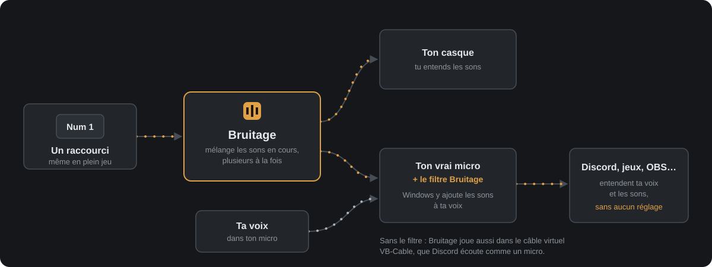
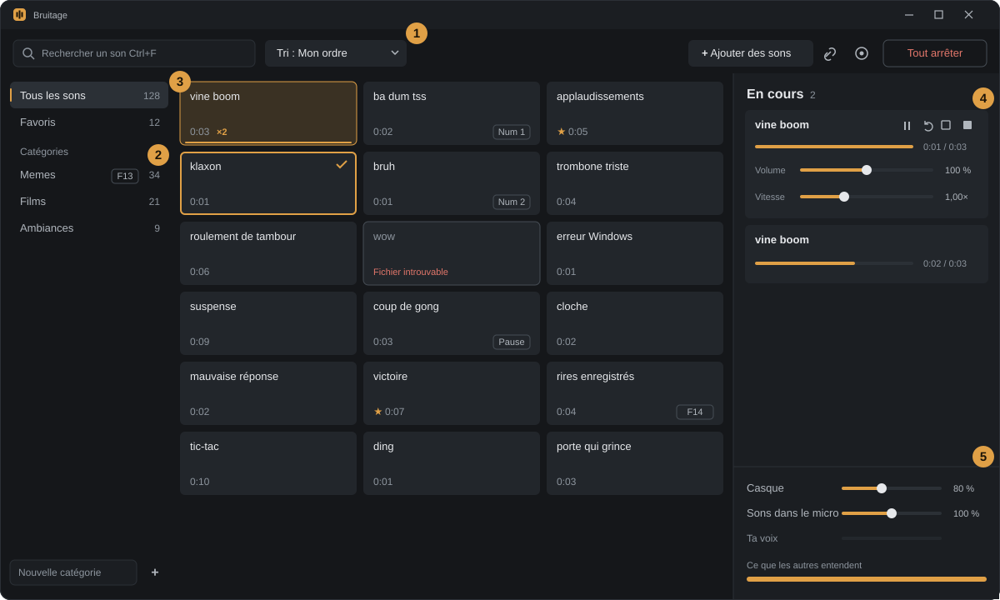

<p align="center">
  
</p>

<h1 align="center">Bruitage</h1>

<p align="center">
  <strong>La soundboard polyphonique pour Windows.</strong><br>
  Plusieurs sons à la fois, envoyés dans ton vrai micro, déclenchés au clavier même en jeu.
</p>

<p align="center">
  <a href="https://github.com/Augaton/bruitage/releases/latest"></a>
  <a href="https://github.com/Augaton/bruitage/actions/workflows/ci.yml"></a>
  
  
  <a href="LICENSE"></a>
</p>

<p align="center">
  <a href="https://github.com/Augaton/bruitage/releases/latest"><strong>Télécharger</strong></a> ·
  <a href="#premiers-pas">Premiers pas</a> ·
  <a href="#questions-fréquentes">Questions fréquentes</a> ·
  <a href="CONTRIBUTING.md">Contribuer</a>
</p>

<p align="center">
  
</p>

Bruitage joue tes bruitages, répliques et musiques pendant que tu parles sur Discord, en jeu ou en
stream. Les autres les entendent comme s'ils sortaient de ton micro, mêlés à ta voix, sans micro
virtuel à configurer. Un seul exe d'environ 13 Mo, sans installation.

> Bruitage s'appelait **Soundpad Improved** jusqu'à la version 0.3. Il n'est affilié ni à Soundpad
> ni à Leppsoft ; il sait seulement lire la bibliothèque de Soundpad pour l'importer.

## Sommaire

- [Fonctionnalités](#fonctionnalités)
- [La fenêtre](#la-fenêtre)
- [Installation](#installation)
- [Premiers pas](#premiers-pas)
- [Gestes et raccourcis](#gestes-et-raccourcis)
- [Envoyer les sons aux autres](#envoyer-les-sons-aux-autres)
- [Données et sauvegarde](#données-et-sauvegarde)
- [Questions fréquentes](#questions-fréquentes)
- [Désinstaller](#désinstaller)
- [Compiler depuis les sources](#compiler-depuis-les-sources)
- [Architecture](#architecture)
- [Contribuer](#contribuer)
- [Licence](#licence)

## Fonctionnalités

**Jouer**

- **Plusieurs sons à la fois**, et le même son plusieurs fois par-dessus lui-même. Un limiteur évite
  la saturation quand ils s'empilent.
- **Réglage en direct de chaque son en cours** : volume, vitesse (et hauteur), position, boucle, pause.
- **Comportement par son** quand on le relance : le superposer, le redémarrer, ou l'arrêter
  (bascule). L'option « un seul son à la fois » reproduit le fonctionnement de Soundpad.
- **Volumes égalisés** : les sons trop forts sont baissés, les faibles remontés.
- **Départ immédiat** : le silence au début des fichiers est coupé, et les sons à raccourci sont
  décodés d'avance.

**Au clavier, même en jeu**

- **Un raccourci global par son**, plus « tout arrêter », « pause / reprise de tout », « monter » et
  « baisser le volume des sons en cours ». Toutes les touches marchent, Pause et F13 à F24 comprises.
- **Un raccourci par catégorie** qui joue un de ses sons au hasard, jamais deux fois le même de suite.

**Envoyer aux autres**

- **Les sons dans ton vrai micro** : un filtre Windows les ajoute au micro, et toutes les applis les
  entendent (Discord, jeux, OBS…) sans réglage de leur côté.
- **Ou le câble virtuel VB-Cable**, avec ta voix mélangée par l'appli et une réduction de bruit
  (RNNoise) en option.
- **Un vumètre** montre ce que les autres entendent.

**Organiser**

- **Import de Soundpad en un clic** : sons, catégories et raccourcis. Le fichier de Soundpad est
  seulement lu, jamais modifié.
- **Sons en ligne** : colle le lien d'un son Voicemod Tuna ou MyInstants, ou d'un fichier audio, et
  l'appli le télécharge sous son titre.
- **Catégories, favoris, recherche** insensible aux accents, tri par titre, par sons les plus joués
  ou dans ton ordre (glisse un son pour le déplacer).
- **Sélection de plusieurs sons** pour les ranger, les mettre en favori ou les retirer d'un coup.
- **Sons introuvables retrouvés** : indique le dossier où tes fichiers ont été déplacés.

**Toujours là**

- **Zone de notification** : fermer la fenêtre la range près de l'horloge, les raccourcis restent
  actifs. L'appli peut se lancer avec Windows.
- **Mises à jour signalées** : un bouton apparaît quand une nouvelle version est publiée.

## La fenêtre

<p align="center">
  
</p>

1. **Recherche et tri.** Ctrl+F pour chercher, le tri « Mon ordre » permet de glisser les sons.
2. **Catégories.** Clic droit sur une catégorie : son raccourci, qui joue un de ses sons au hasard.
3. **Les sons.** Un clic joue ; la barre orange suit la lecture et « ×2 » compte les instances.
   Clic droit ou `•••` pour modifier. Ctrl ou Maj + clic pour sélectionner.
4. **En cours.** Chaque instance a son volume, sa vitesse, sa position, sa boucle et sa pause.
   Le bouton « Garder » enregistre son volume et sa vitesse comme réglages du son.
5. **Volumes.** Ton casque, les sons dans le micro, ta voix (en mode VB-Cable), et le niveau envoyé
   aux autres.

*Schéma de l'interface, pas une capture d'écran.*

## Installation

1. Télécharge `Bruitage-<version>.exe` dans les
   [Releases](https://github.com/Augaton/bruitage/releases/latest). C'est un seul exe, sans
   installation, pour Windows 10 et 11 en 64 bits.
2. Lance-le. Il n'est pas signé : Windows SmartScreen peut afficher « Windows a protégé votre
   ordinateur ». Clique sur « Informations complémentaires », puis « Exécuter quand même ».

Chaque version publiée est compilée et testée par la [CI](.github/workflows/ci.yml) à partir de ce
dépôt, filtre micro compris.

## Premiers pas

1. **Ajoute des sons** : « Importer depuis Soundpad » si tu l'utilisais, sinon glisse des fichiers
   ou des dossiers sur la fenêtre, ou colle (Ctrl+V) le lien d'un son.
2. **Choisis comment les autres t'entendent** : Réglages, Envoi aux autres, **« Mon micro, avec le
   filtre »**, puis « Installer le filtre ». Windows demande l'autorisation administrateur, et le son
   du PC se coupe une seconde. Dans Discord, garde ton micro habituel.
3. **Coupe la suppression de bruit de Discord** (Krisp) : elle prend la musique pour du bruit et
   l'efface.
4. **Donne des raccourcis à tes sons** : clic droit sur un son, « Raccourci clavier global ».
   Préfère le pavé numérique, Pause, F13 à F24 ou une combinaison avec Ctrl ou Alt : la touche
   choisie n'arrive plus aux autres applis tant que Bruitage est ouvert.
5. **Ferme Soundpad** s'il tourne : deux applis ne peuvent pas prendre la même touche.

## Gestes et raccourcis

| Geste | Effet |
|---|---|
| Clic sur un son | Le joue, selon son comportement (superposer par défaut) |
| Clic droit, ou bouton `•••` | Modifier : titre, volume et vitesse par défaut, comportement, raccourci, catégories, favori |
| Ctrl+clic, Maj+clic, Ctrl+A | Sélectionner plusieurs sons. Échap désélectionne |
| Glisser un son | Le déplacer, avec le tri « Mon ordre » et sans recherche en cours |
| Clic droit sur une catégorie | Son raccourci, qui joue un de ses sons au hasard |
| Glisser des fichiers ou dossiers | Les ajouter ; dans une catégorie ouverte, ils y sont rangés |
| Ctrl+V d'un lien, ou bouton lien | Ajouter le son d'une page Voicemod Tuna ou MyInstants, ou un fichier audio en ligne |
| Ctrl+F | Rechercher |
| Clic sur l'icône de la zone de notification | Rouvrir la fenêtre ; clic droit pour « Tout arrêter » ou « Quitter » |

## Envoyer les sons aux autres

**Le filtre micro (recommandé).** Comme Soundpad, Bruitage installe dans Windows un filtre audio
(un APO d'effet) sur ton micro lui-même : le service audio de Windows y ajoute les sons, et toutes
les applis reçoivent ce micro modifié.

- Le filtre se pose sur chaque micro branché dont l'emplacement d'effet est libre, ou tenu par
  Soundpad. Il prend alors la place de celui de Soundpad, qui n'envoie plus de son tant qu'il est là.
- Les micros qui ont déjà un effet du fabricant ne sont pas touchés.
- « Retirer le filtre » rend à chaque micro l'effet qu'il avait avant, celui de Soundpad compris.
- Sans Bruitage ouvert, le filtre laisse passer le micro tel quel.

**Le câble virtuel VB-Cable.** Sans filtre, Bruitage joue dans ton casque et dans un câble audio
virtuel gratuit, que Discord écoute comme un micro.

1. Installe [VB-Cable](https://vb-audio.com/Cable/) (`VBCABLE_Setup_x64.exe` en administrateur),
   puis redémarre le PC.
2. Dans Bruitage, Réglages, Envoi aux autres : « CABLE Input ».
3. Dans Discord, périphérique d'entrée : **« CABLE Output (VB-Audio Virtual Cable) »**.
4. Ta voix passe alors par Bruitage : coche « Réduction de bruit sur ma voix » si besoin.

## Données et sauvegarde

- La bibliothèque et les réglages sont dans `%APPDATA%\bruitage\library.json`.
- À chaque lancement, la bibliothèque est copiée dans `library.json.bak`. Après une erreur, quitte
  Bruitage (clic droit sur son icône, « Quitter ») et remets ce fichier à la place de `library.json`.
- Les fichiers audio restent où ils sont : retirer un son ne supprime jamais le fichier. Les sons
  ajoutés depuis un lien sont enregistrés dans `%APPDATA%\bruitage\sons`.
- Venant de Soundpad Improved, le dossier `%APPDATA%\soundpad-improved` est déplacé au premier
  lancement, et le lancement avec Windows suit.

**Formats** : mp3, wav, ogg, opus et webm (Vorbis ou Opus, dont les messages vocaux de Discord),
flac, m4a et aac, aiff.

**Réseau** : Bruitage ne se connecte qu'à GitHub, au démarrage, pour savoir si une version plus
récente existe, et aux liens que tu lui donnes. Toujours en HTTPS, par le système de Windows (proxy
et certificats compris). Aucune télémétrie.

## Questions fréquentes

<details>
<summary><strong>Les autres n'entendent pas mes sons.</strong></summary>

- Mode filtre : Réglages, Envoi aux autres. Le cadre sous la liste dit sur quels micros le filtre
  est actif, et s'il est en marche. Vérifie que Discord utilise l'un de ces micros.
- Coupe la suppression de bruit de Discord (Krisp) : elle efface la musique.
- Mode VB-Cable : dans Discord, l'entrée doit être « CABLE Output », pas ton micro.
- Le vumètre « Ce que les autres entendent » doit bouger quand un son joue.
</details>

<details>
<summary><strong>Une touche est barrée en rouge sur un son.</strong></summary>

Une autre appli a déjà pris cette touche, souvent Soundpad resté ouvert. Ferme-la, ou choisis
une autre touche.
</details>

<details>
<summary><strong>Mon raccourci empêche cette touche de marcher ailleurs.</strong></summary>

C'est le prix d'un raccourci global : Windows le donne à Bruitage avant les autres applis. Prends
des touches dont tu ne te sers pas ailleurs : pavé numérique, Pause, F13 à F24, ou Ctrl/Alt + touche.
</details>

<details>
<summary><strong>Comment quitter vraiment l'appli ?</strong></summary>

Fermer la fenêtre la range dans la zone de notification, près de l'horloge. Clic droit sur
l'icône, « Quitter ». On peut aussi décocher ce rangement dans les réglages.
</details>

<details>
<summary><strong>Un son affiche « Fichier introuvable ».</strong></summary>

Le fichier a été déplacé, renommé ou supprimé. Clic droit sur le son, « Chercher dans un
dossier… » : Bruitage retrouve les fichiers déplacés d'après leur nom, pour tous les sons
introuvables d'un coup.
</details>

<details>
<summary><strong>Windows dit que l'appli n'est pas reconnue.</strong></summary>

L'exe n'est pas signé (un certificat de signature coûte cher pour un projet gratuit).
« Informations complémentaires », puis « Exécuter quand même ». Le code est entièrement dans ce
dépôt, et chaque exe publié est construit par la CI GitHub.
</details>

## Désinstaller

1. Si tu as installé le filtre : Réglages, « Retirer le filtre ». Chaque micro retrouve l'effet
   qu'il avait avant.
2. Décoche « Lancer avec Windows », puis quitte l'appli (clic droit sur son icône, « Quitter »).
3. Supprime l'exe, et le dossier `%APPDATA%\bruitage` si tu ne veux pas garder ta bibliothèque.

## Compiler depuis les sources

Il faut Windows, [Rust](https://rustup.rs), [CMake](https://cmake.org) (pour libopus, le décodeur
Opus) et le g++ de [MSYS2](https://www.msys2.org) (UCRT64), dans le PATH.

```
native\build.cmd        # le filtre micro ; l'exe l'embarque si native\bin existe
cargo run --release     # ou cargo build --release : l'exe est dans target\release
```

Tests et vérifications, ceux que la CI passe :

```
cargo fmt --check
cargo clippy --all-targets -- -D warnings
cargo test                            # logique, mélangeur, limiteur, anneau du filtre, décodage
cargo test -- --ignored               # téléchargement réel depuis Voicemod Tuna et MyInstants
native\bin\test_apo.exe native\bin    # filtre micro de bout en bout, sans droits administrateur
```

Variables de test : `SPI_USER_DATA=<dossier>` isole le profil, et l'appli tourne alors à côté de
celle de tous les jours ; `SPI_MIC_SHM=Local\<nom>` remplace la mémoire partagée du filtre, pour la
tester avec `native\bin\test_apo.exe native\bin --listen Local\<nom> <secondes>` à la place
d'audiodg.

## Architecture

Bruitage est écrit en Rust : [egui](https://github.com/emilk/egui) pour l'interface,
[cpal](https://github.com/RustAudio/cpal) pour les sorties audio,
[symphonia](https://github.com/pdeljanov/Symphonia) et libopus pour le décodage,
[rubato](https://github.com/HEnquist/rubato) pour le rééchantillonnage. Le filtre micro est en C++.

| Fichier | Rôle |
|---|---|
| `src/main.rs` | Démarrage, une seule instance à la fois |
| `src/state.rs` | L'état de l'appli et ses actions (lecture, sauvegarde, raccourcis, filtre), partagés entre la fenêtre et le fil des raccourcis : un raccourci joue même fenêtre fermée |
| `src/ui/` | L'interface : `mod.rs` la fenêtre, `dialogs.rs` l'éditeur de son et les réglages, `widgets.rs` les pads et curseurs, `theme.rs` couleurs, polices et icône, `capture.rs` la saisie d'un raccourci, `tray.rs` l'icône de la zone de notification |
| `src/audio/decode.rs` | Fichier vers PCM stéréo 48 kHz, silence de début coupé, gain d'égalisation |
| `src/audio/mixer.rs` | Les voix, rendues par chaque sortie avec son propre curseur |
| `src/audio/engine.rs` | Cache de décodage, sorties, ta voix et sa réduction de bruit (RNNoise), limiteur, envoi au filtre micro au rythme de 48 kHz |
| `src/audio/ring.rs` | L'écriture dans la mémoire partagée du filtre (`native/shared.h`) |
| `src/hotkeys.rs` | Raccourcis globaux via l'API Windows `RegisterHotKey`, toutes touches comprises |
| `src/filter.rs` | État, installation et retrait du filtre, par `native/mic-filter.ps1` (embarqué avec la DLL) |
| `src/link.rs` | Un son depuis un lien : trouvé dans la page (schema.org, puis Open Graph), téléchargé en HTTPS seulement par WinHTTP, plafonné, gardé seulement s'il se décode |
| `src/autostart.rs` | Le lancement avec Windows (clé `Run` de l'utilisateur) |
| `src/model.rs`, `src/keys.rs`, `src/soundpad.rs`, `src/store.rs` | La bibliothèque, les noms de touches, l'import Soundpad, les fichiers |
| `native/apo.cpp` | Le filtre : un APO d'effet de point de terminaison chargé par `audiodg.exe`. Il ajoute au micro le son lu dans la mémoire partagée, avec un rééchantillonnage qui suit la dérive entre l'horloge de l'appli et celle du micro |
| `native/mic-filter.ps1` | État, installation et retrait du filtre (registre du micro, sauvegarde de l'effet d'origine) |

**Sécurité du filtre.** PowerShell est pris dans System32 par son chemin complet. Il n'exécute le
script que s'il a l'empreinte SHA-256 de celui de l'exe. La DLL est vérifiée une fois copiée dans
Program Files, là où seuls les administrateurs peuvent écrire, avant que le service audio la charge.
Le filtre garde les noms internes qu'il avait sous le nom Soundpad Improved, pour que les filtres
déjà installés continuent de marcher.

## Contribuer

Les rapports de bug, idées et contributions sont les bienvenus. Lis [CONTRIBUTING.md](CONTRIBUTING.md)
avant d'ouvrir une pull request, et [SECURITY.md](SECURITY.md) pour signaler une faille. Les
changements de chaque version sont dans le [CHANGELOG](CHANGELOG.md).

## Licence

[MIT](LICENSE). Bruitage s'appuie sur des bibliothèques libres sous leurs propres licences, dont
egui (MIT ou Apache 2.0), cpal (Apache 2.0), symphonia (MPL 2.0), libopus (BSD), RNNoise par
nnnoiseless (BSD) et rubato (MIT ou Apache 2.0).
